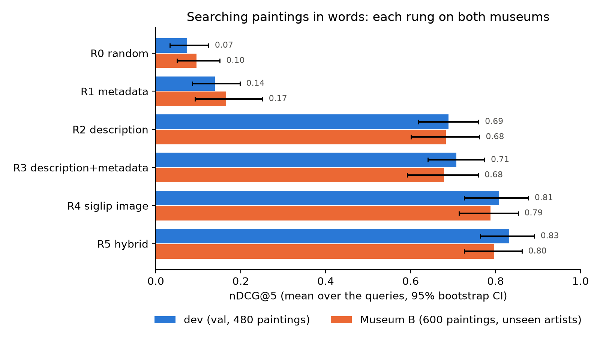
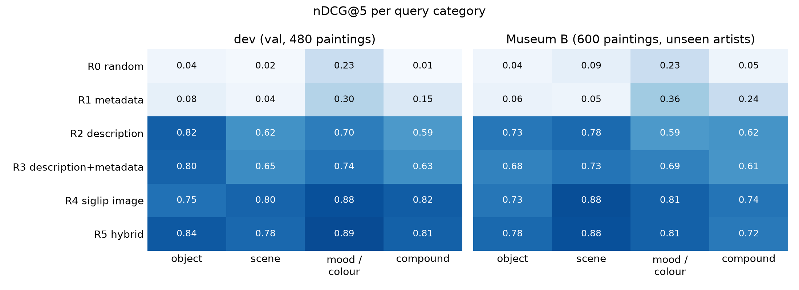
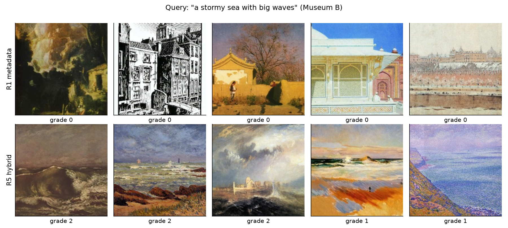
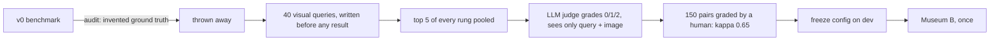
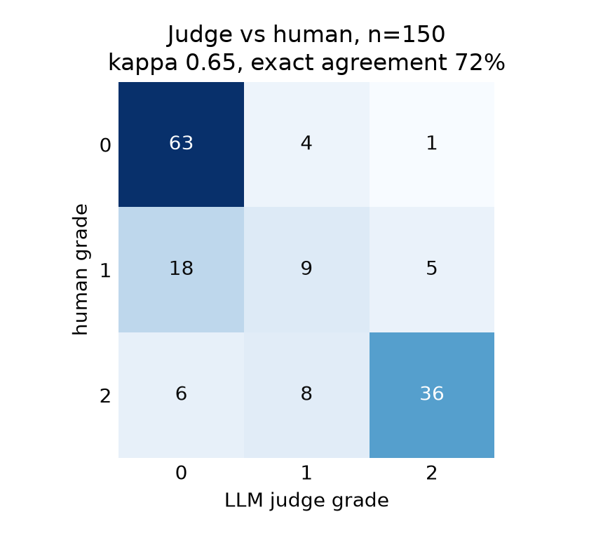

# NLP: executive summary

A visitor types what they want to see ("a stormy sea with big waves") and the kiosk shows 5 paintings. We built the
search one step at a time, measured every step on the same 40 queries, then ran everything once on a museum with
artists never seen before (Museum B). Figures come from [`N00_executive_summary`](../src/deep_learning_project_waerniers_lamy_mahieddine/nlp/N00_executive_summary.ipynb); the
protocol is in [ADR 0013](0013-nlp-evaluation-protocol.md).

## Results in short

- **Metadata alone does not work.** Genre, style and artist score nDCG@5 0.14 to 0.17, barely above random (0.07 to
  0.10): a visitor asks for what is *in* the painting, and the dataset does not record it.
- **Looking at the image is what works.** Searching with the text of a VLM description adds **+0.55** nDCG@5, searching
  the image directly with SigLIP adds **+0.67** (both p < 0.001 after Holm correction, on both museums).
- **The fusion of the two does not add measurably.** Hybrid vs SigLIP: +0.024 on dev (p = 0.54), +0.010 on Museum B
  (p = 0.78). It helps on object queries (+0.09 and +0.05), but those are about 12 queries and were not tested.
- **The gains hold on unseen artists.** The gaps to the baseline shrink by only 0.03 to 0.06 on Museum B.
- **Recommendation: SigLIP alone (R4).** Same quality as the hybrid within the noise, no paid call, no description to
  generate for new paintings, 82 ms per query on CPU.

| Rung | What it searches | dev nDCG@5 | Museum B nDCG@5 |
|---|---|---|---|
| R0 random | nothing (the floor) | 0.07 | 0.10 |
| R1 metadata | genre + style + artist (MiniLM) | 0.14 | 0.17 |
| R2 description | 2-sentence description by Qwen3-VL-8B (MiniLM) | 0.69 | 0.68 |
| R3 description + metadata | both texts (MiniLM) | 0.71 | 0.68 |
| R4 SigLIP image | the image itself, query through SigLIP's text tower | 0.81 | 0.79 |
| R5 hybrid | R3 + R4, per-query z-scores, equal weight (not tuned) | 0.83 | 0.80 |

## Where each step helps

Descriptions are best on objects (they name what is there); SigLIP is best on scenes, moods and colours, which a
45-word text summarises poorly. The metadata only helps a little on mood and colour, through the style names.

## How it was measured

- **Metric:** nDCG@5 with grades 0 (no), 1 (partial) and 2 (clear match), because the kiosk shows 5 paintings. 95%
  bootstrap intervals over queries; only 3 comparisons fixed in advance, paired randomization test, Holm correction.
- **Judge:** `google/gemini-3.8-flash`, another family than the Qwen describer so it does not favour Qwen's text. It
  sees only the query and the image, never the rung. About 1,600 pairs were graded.
- **Judge validated:** 150 random dev pairs graded blind by a human: linear-weighted **kappa 0.65**, **72% exact
  agreement**. When they disagree, the judge is usually stricter (it gives 0 where the human gave 1), so it does not
  inflate the scores.
- **Museum B once:** after dev, the models, prompts, weight and hashes of the descriptions and queries were frozen; the
  test notebook refuses to run if any of them changed.

## Cost

| | Cost |
|---|---|
| Whole project: descriptions, judge, every trial and rerun | **3.38 $** (OpenRouter bill) |
| Describing new paintings (only for R2, R3, R5) | about **0.06 $ per 1,000 paintings** |
| Judge (evaluation only, not needed by the kiosk) | about 0.001 $ per graded pair |
| Embeddings of the collection, every visitor query | 0 $, local CPU |

Almost the whole bill is the price of measuring, not of the system. We first tried to describe the paintings for free
with Qwen2.5-VL-3B on Colab: the results were promising, but Colab's limits did not let it run on the 1,080 paintings
(and Kaggle refused internet access). We chose a paid API after estimating under 2 €, and the final bill, including
the judge, is 3.38 $.

## Trade-offs and recommendation

Measured on this laptop's CPU (median per query, collection already indexed). Indexing time and model sizes measured in
the same way; one painting's SigLIP embedding is 768 floats, so 3 KB.

| Option | nDCG@5 dev | nDCG@5 Museum B | Paid API | Indexing a new painting | One query | Model at query time | Parts to maintain |
|---|---|---|---|---|---|---|---|
| R1 metadata | 0.14 | 0.17 | no | needs genre, style, artist | 34 ms | MiniLM, 23 M weights | metadata + 1 model |
| R3 description + metadata | 0.71 | 0.68 | yes, about 0.06 $ per 1,000 paintings | 1 VLM call | about 13 ms | MiniLM, 23 M weights | VLM API + prompt + 1 model |
| **R4 SigLIP image** | **0.81** | **0.79** | **no** | **174 ms on CPU** | **82 ms** | **SigLIP text tower, 110 M weights** | **1 model** |
| R5 hybrid | 0.83 | 0.80 | yes, as R3 | both | 115 ms | both | everything above |

- **What each step buys.** Metadata to description: +0.55 for a paid call per painting and an API to keep alive.
  Description to SigLIP: +0.10 for *less* infrastructure (no API, no text). SigLIP to hybrid: +0.02 on dev and +0.01 on
  Museum B (p = 0.54 and 0.78, so not distinguishable from zero), for the whole description pipeline and +33 ms.
- **What the hybrid would still bring.** Object queries (+0.09 on dev, +0.05 on Museum B, about 12 queries, not
  tested) and religious paintings, where the description finds the iconography (the Virgin, a crucifixion) better than
  the image.
- **Recommendation: SigLIP alone.** Offline, the image tower turns each painting into a vector once (about 3 minutes per
  1,000 paintings on CPU) stored next to its id: 1.8 MB for this museum, 30 MB for 10,000 paintings, in a `.npy` or
  Parquet file. Online, the text tower encodes the visitor's query (about 100 ms) and a dot product with all the vectors
  gives the 5 best (16 ms even for 100,000 paintings): no vector database, no API, no recurring cost. The storage is tiny;
  the model is not (110 M weights, about 440 MB in float32), but it runs on a plain CPU.
- **When to choose the hybrid instead.** If the museum wants the descriptions anyway (to show or read out why a
  painting was proposed, for accessibility), the hybrid comes almost free and helps on objects.

## Perspectives (not built)

- **The two branches are complementary**: their per-query scores are barely correlated (0.09 on dev, 0.37 on
  Museum B). Choosing the better branch for each query would give 0.88 and 0.84: about +0.05 above the hybrid, a
  ceiling that a smarter fusion can only approach.
- **The best branch depends on the genre**: the description wins on religious paintings on both museums, the image on
  portraits. A fusion learned on the scores and on the genre *predicted by our vision model* would link the two halves
  of the project; with 40 queries, its gain (at most a few points) would not be measurable here.
- **Re-ranking**: let a VLM look at SigLIP's top 20 with the query in hand, the way the judge does, at the price of
  seconds and a paid call per query.

## Lessons learned

- **Check the ground truth before the model.** The v0 benchmark had relevant ids written without looking at the
  images: 13 of 74 did not exist, others had the wrong genre. Every v0 number was void (`results/nlp/v0_*`).
- **Limit length in the prompt, not with `max_tokens`.** A 60-token cap cut 104 of 105 descriptions mid-sentence.
- **Ask an LLM judge yes/no questions, not a grade.** Asked for 0/1/2, it wrote "no skull visible. Grade: 1". Two
  yes/no questions with the grade derived by rule fixed it.
- **Absolute nDCG depends on the pool.** R2 on dev dropped from 0.76 to 0.69 once SigLIP found relevant paintings the
  descriptions missed. Compare rungs only on the final pool.
- **Simple won.** The most useful system is one pretrained model with no training, no text and no API.

## Limits

40 queries: gaps of a few points are not detectable, so read the intervals before the p-values. The judge was
validated on dev only. Relevant paintings that no rung found stay invisible (pool miss rate on dev: 10.8%, estimated
with random paintings). Dev and Museum B absolute scores are not comparable (480 vs 600 paintings); the gaps between
rungs are. Descriptions almost never name the artist (0% on dev, 0.2% on Museum B), so the VLM is not recognising
famous paintings.
